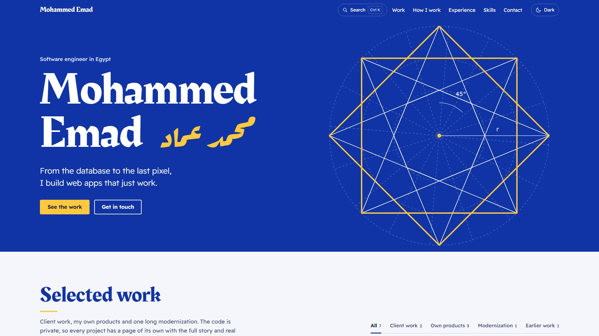

# Mohammed Emad - portfolio

The personal site of Mohammed Emad, a software engineer in Egypt who builds full-stack web apps: one home page
about the work, and a page for every project.

**Live site:** https://myportfolio-iota-navy-36.vercel.app



## What is on the site

- **One home page** with the selected work, how I work, experience, skills, smaller and earlier work, and a contact
  form.
- **A page for every project** (`/work/<slug>/`): what it is, its figures, my part in it, and real screenshots on a
  desktop and a phone. The list of work can be narrowed by kind: client work, own products, modernization.
- **A command palette.** Press Ctrl+K, or the Search button, to jump to any section or project, switch the theme or
  open a profile, all from the keyboard.
- **A light and a dark theme.** The first visit follows the system setting; a choice is remembered.
- **Latin and Arabic type.** The name is written in both scripts, in fonts the site serves itself (Rakkas for the
  titles, Readex Pro for the text), so no request goes to another server.
- **Motion in CSS only.** The first screen opens with the name rising and the Arabic name written from the right,
  pictures unroll as they come into view, and blocks rise into place while scrolling. Everything stands still for a
  visitor who has asked their system to reduce motion.
- **A contact form** that says clearly whether the message went out, with a trap for bots.

## How it is built

| Part | How |
|---|---|
| Stack | React 19, TypeScript, Vite 7 and Tailwind CSS 4. No animation or 3D library. |
| Real HTML for every page | At build time `tools/build/build.mjs` writes every page to its own HTML file, with its own title, description, share picture and structured data; React takes it over in the browser. The text is there before any JavaScript arrives, for visitors, search engines and link previews alike. |
| Content as data | Every text, job, skill and project is a JSON file in `content/`, checked against a schema (`src/content/schema.ts`) by the tests and by the build, so a broken file cannot go online. |
| An admin panel without a server | [Pages CMS](https://pagescms.org) edits the files in `content/` through forms and saves each change as a commit. There is no database and no admin page on the site ([docs/admin.md](docs/admin.md)). |
| Pictures sized for the screen | Every screenshot has WebP copies in several widths, so a phone downloads a picture of its own size. A weight budget per page is held by the tests ([docs/page-weight.md](docs/page-weight.md)). |
| Accessibility | Browser tests run the axe rules on every page in both themes, on a desktop and a phone size, and use the site by keyboard. |
| The look | All colours are tokens for the two themes at the top of `src/index.css`: Egyptian blue and saffron. |
| Contact form | [EmailJS](https://www.emailjs.com), loaded only when a message is sent. |
| Speed of real visits | [Vercel Speed Insights](https://vercel.com/docs/speed-insights) measures the Core Web Vitals of visits to the live site. Its script loads after the page, and only in the build Vercel makes for production. |

## Run it locally

You need [Node.js](https://nodejs.org/) 22.18 or newer, with npm. The commands are written for Windows PowerShell,
one per line.

```powershell
git clone https://github.com/Moe-Emad/portfolio-site.git
```

```powershell
cd portfolio-site
```

```powershell
npm ci
```

```powershell
npm run dev
```

The site is then on http://localhost:5173 and reloads on every change. The contact form needs three EmailJS values:
copy `.env.example` to `.env` and fill them in. Without them the site runs and shows a short notice in place of the
form.

## Scripts

| Command | What it does |
|---|---|
| `npm run dev` | The site on http://localhost:5173, reloading on every change |
| `npm run build` | The production site in `dist/`: every page as its own HTML file, `robots.txt`, and `sitemap.xml` when `VITE_SITE_URL` is set |
| `npm run preview` | Serves that build on http://localhost:4173 |
| `npm run gate` | Every check in one command: code style, types, unit and tool tests, the lock file, the secret scan, `npm audit` and the build. GitHub runs it on every pull request |
| `npm run test:unit` | Unit tests, and the check of every file in `content/` |
| `npm run test:browser` | Playwright and axe on a desktop and a phone size, against a build of its own |
| `npm run test:tools` | Tests of the build and the developer tools |
| `npm run lint` / `npm run typecheck` | ESLint (warnings fail too) / TypeScript |
| `npm run weight` | Measures what a page downloads, on both sizes, for [docs/page-weight.md](docs/page-weight.md) |
| `npm run pictures` | Fills in the size of new screenshots and makes their WebP copies |
| `npm run cms-config` | Writes `.pages.yml`, the forms of the admin panel, from `tools/build/pages-cms.cjs` |
| `npm run og-image` | Redraws `public/og-image.png`, the picture shown in link previews |
| `npm run hooks` | Switches on the git hooks of the project, once per clone |
| `npm run locks` | Checks the lock file: in step with `package.json`, packages from the npm registry only, with checksums |
| `npm run secrets` | Scans the whole history for keys and passwords |

## Changing what the site says

Everything the site shows is in `content/`; no component needs to change.

| To change | Edit |
|---|---|
| Name, headline, the "How I work" text, the links | `content/profile.json` |
| Jobs | `content/experience.json` |
| Skills and their groups | `content/skills.json` |
| A project | `content/projects/<slug>.json`, with its screenshots in `public/images/projects/<slug>/` |
| Smaller and earlier work | `content/archive.json` |

A new file in `content/projects/` gets its page at `/work/<slug>/` and its place in the command palette by itself,
unless it is marked as a draft. `npm run test:unit` names the file and the field when something is wrong.

## Where things are

| Folder | What is in it |
|---|---|
| `content/` | The texts and the projects (JSON) |
| `public/` | Files served as they are: screenshots, the favicon, the share picture |
| `src/components/` | The parts of the pages |
| `src/content/` | The shape of the content files and its check |
| `src/lib/` | Logic kept apart from the pages so it can be tested alone: the contact form, the command palette, the theme, the picture copies |
| `src/index.css` | The whole look: the colours of both themes, type, layout and motion |
| `tests/browser/` | The browser tests |
| `tools/build/` | The build: pages to HTML, the share picture, the picture copies, the forms of the admin panel |
| `tools/dev/` | The gate, the git hooks and their tests |
| `docs/` | The admin and deploy guides, the page weight, screenshots of each change, the tracker |

## How it is made

Every change is planned as a row in [docs/tracking/CODE-TRACKER.md](docs/tracking/CODE-TRACKER.md) with a GitHub
issue, made on its own branch with a test that fails without it, and merged through a pull request once the gate
and the browser tests pass on GitHub. Merged changes are listed in [CHANGELOG.md](CHANGELOG.md), and lessons that
cost time once are in [docs/pitfalls.md](docs/pitfalls.md).

## Deploying

Every page is a plain HTML file, so any static host can serve the site. The live site is on Vercel, which builds
and publishes every merge to `main` with the settings and headers in `vercel.json`. [docs/deploy.md](docs/deploy.md)
has the settings, the EmailJS steps and a checklist for after a deploy.
